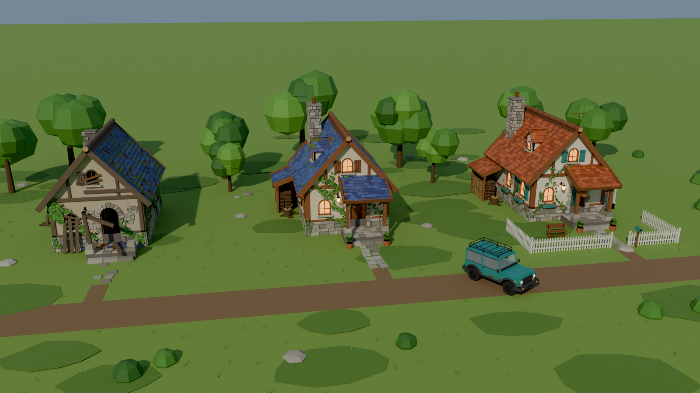
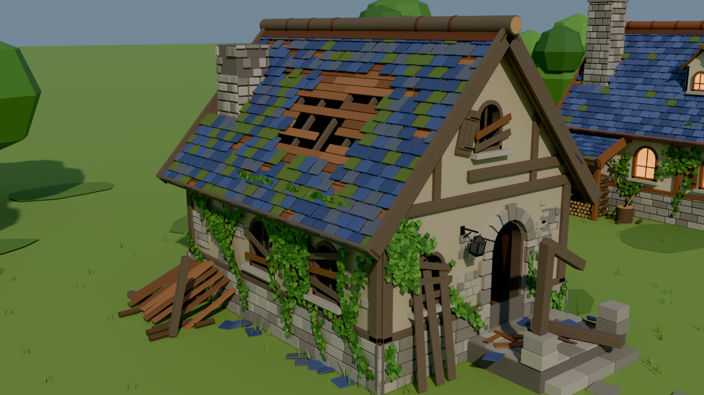
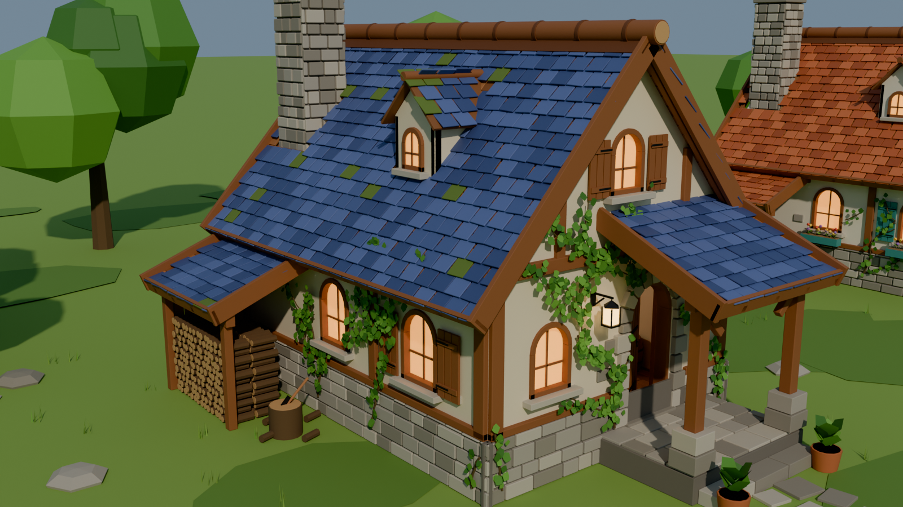
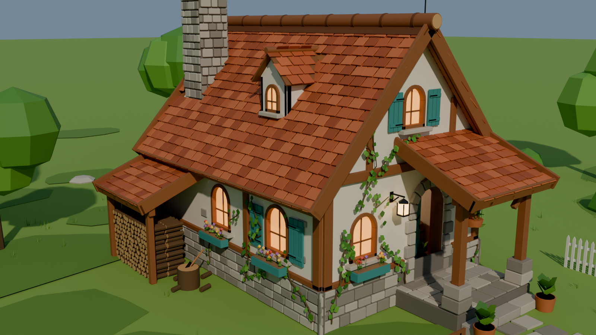
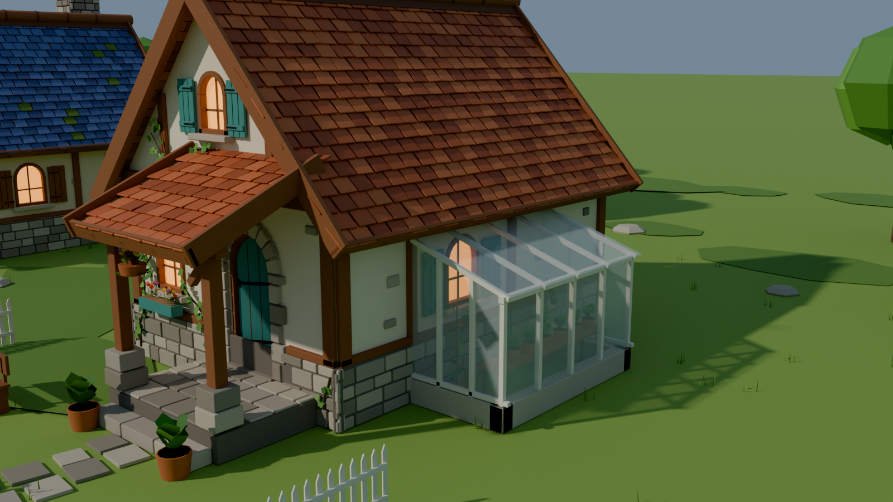
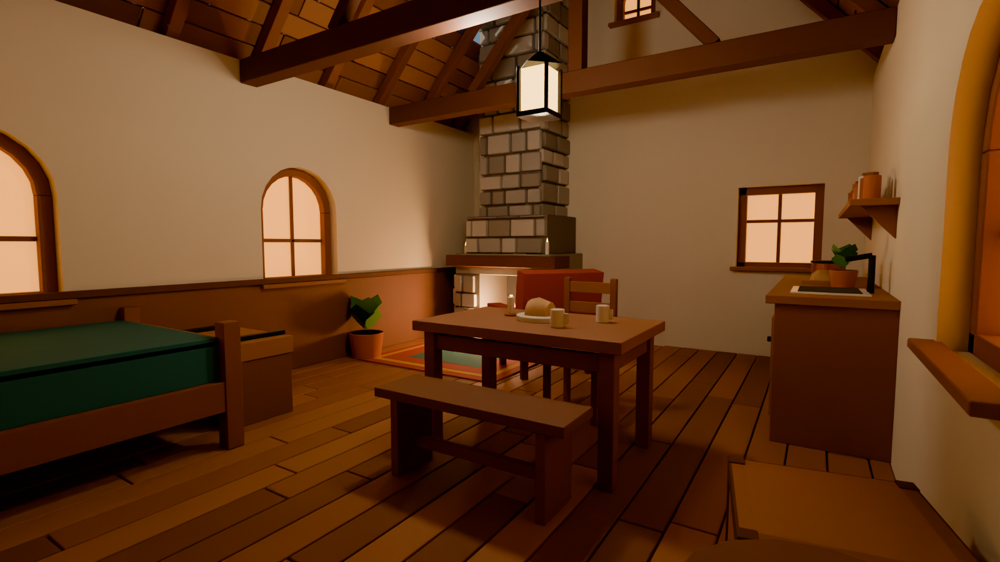
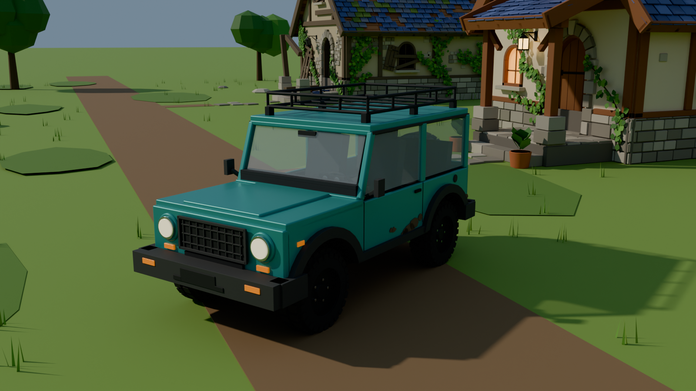

# Island Game Assets 🏝️

Orolda sarguzasht o'yini (Godot 4) uchun stilize qilingan 3D modellar. Hammasi Blender 5.1'da
Python skriptlar bilan yaratilgan.

## Uy — 3 xil variant, ichi bilan
O'yin hikoyasi: eski uyni topasan → ta'mirlaysan → kengaytirasan.



| Eski uy | Ta'mirlangan uy | Kengaytirilgan uy |
|---|---|---|
|  |  |  |

Kengaytirilgan uy — issiqxona, gul qutilari, panjara:



Uy ichi (ta'mirlangan variant):



## Jip


## Qurollar


## Fayllar
- `exports/*.glb` — Godot'ga to'g'ridan-to'g'ri import qilinadigan modellar (uy ×3, jip)
- `env_pack.blend` — uylar + jip sahnasi, `weapon_pack.blend` — qurollar
- `blender_scripts/` — hamma modellarni yasaydigan skriptlar
- `renders/` — render rasmlari
- `CLAUDE.md` — Claude Code uchun loyiha haqida to'liq ma'lumot

## Qayta qurish
Blender → Scripting → `blender_scripts/build_env.py` (yoki `build_all.py`) → Run Script

yoki terminaldan (render + Godot eksport bilan):
```bash
blender --background --factory-startup --python blender_scripts/render_headless.py -- --build build_env.py --blend env_pack.blend --export --shot=Cam_Overview
```
