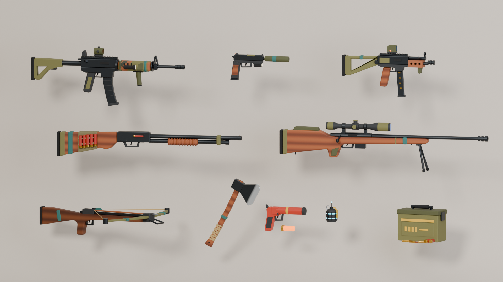
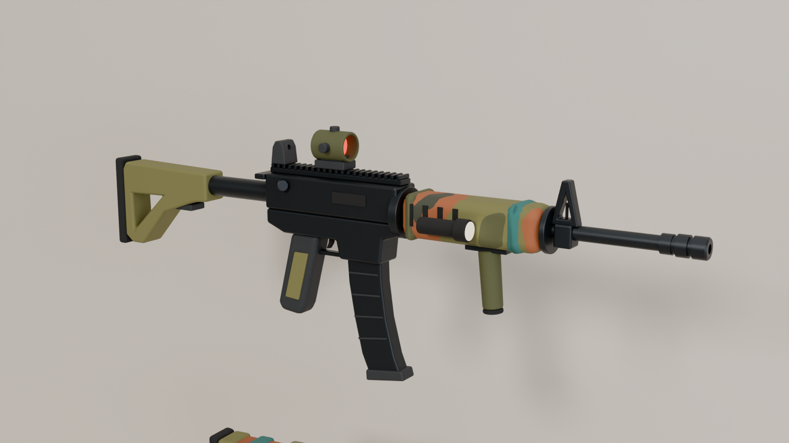

# Island Weapon Pack 🏝️

Orolda sarguzasht o'yini uchun stilize qilingan qurol va buyumlar to'plami. Hammasi Blender 5.1'da
Python skriptlar bilan yaratilgan.




## Tarkibi
**Asosiy qurollar:** avtomat (AR), to'pponcha, SMG, drobovik, snayper miltig'i. Ularga qo'shilgan qismlar:
nishonlar, fonar, glushitel, bipod, patronli tasma.

**Yangi buyumlar:** arbalet, bolta, signal to'pponchasi, EMP granata, o'q-dori qutisi.

## Fayllar
- `weapon_pack.blend` — tayyor sahna (har bir buyum o'z kolleksiyasida)
- `blender_scripts/` — modellarni yasaydigan skriptlar (`build_all.py` hammasini qayta quradi)
- `renders/` — render rasmlari
- `CLAUDE.md` — Claude Code uchun loyiha haqida to'liq ma'lumot

## Qayta qurish
Blender → Scripting → `blender_scripts/build_all.py` → Run Script

yoki terminaldan:
```bash
blender --background --factory-startup --python blender_scripts/render_headless.py -- --samples 64
```
